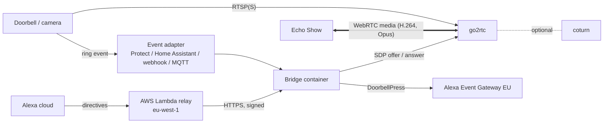

# Doorbridge

> **Status: early design – not usable yet.** There is no runnable code in this repository yet. Planning happens in the [issues](https://github.com/strausmann/doorbridge/issues) and [milestones](https://github.com/strausmann/doorbridge/milestones).

Doorbridge is a self-hosted, open-source bridge that turns a camera doorbell into a video doorbell that works with Amazon Alexa, in the way Ring doorbells behave on an Echo Show. The first supported source is UniFi Protect; other sources plug in through adapters.

## Who is this for?

Doorbridge is **not a plug-and-play skill** that you enable in the Alexa app. It is aimed at technically experienced self-hosters who build the setup for themselves, following the documentation.

You need:

- your own Docker host (amd64 or arm64)
- an Amazon Developer account (free) and an AWS account for the Lambda function (always-free tier)
- an endpoint reachable from the internet via HTTPS on port 443 with a valid certificate (reverse proxy or tunnel of your choice), only for the directive and OAuth endpoints
- a doorbell or camera with an RTSP(S) stream in H.264, plus a source of ring events (UniFi Protect, Home Assistant, webhook)
- an Echo Show on the same Amazon account
- working knowledge of Docker Compose, reverse proxies and networking (WebRTC ports or TURN)

The documentation will walk through skill, Lambda function, account linking and Alexa app step by step, but it assumes this background.

## Planned features

- announcement or chime on the selected Echo devices when the doorbell is pressed
- automatic live view on the Echo Show when the doorbell is pressed
- live view on demand by voice ("Alexa, show the front door"), also for further cameras
- optionally, show a second camera covering the entrance, or a combined image, when the doorbell is pressed
- two-way audio (talkback) with the doorbell from the Echo Show

## Why not RTSP-based solutions?

Existing tools such as Monocle expose cameras through the Alexa interface `CameraStreamController`. Alexa devices then simply play an RTSP stream; the gateway only tunnels it and does not process it ([Monocle tips](https://monoclecam.com/tips), [Monocle Gateway](https://monoclecam.com/gateway)). That is enough for on-demand viewing by voice, but `CameraStreamController` is a playback-only interface:

- It cannot raise **doorbell events**. A ring with automatic live view needs `Alexa.DoorbellEventSource` together with `Alexa.RTCSessionController` on the same endpoint ([DoorbellEventSource](https://developer.amazon.com/docs/device-apis/alexa-doorbelleventsource.html)).
- It cannot do **two-way audio**. Talkback on the Echo Show exists only with the WebRTC-based `RTCSessionController` ([About the Real-Time Communication Interface](https://developer.amazon.com/docs/device-apis/about-alexa-rtc.html)).

Doorbridge therefore uses `RTCSessionController` (WebRTC) and replaces such a setup instead of complementing it. Details: [research, section 6](docs/research/alexa-video-doorbell.md#6-existing-solutions-scope).

## Architecture

| Component | Role |
|-----------|------|
| Lambda relay | Receives Alexa directives and forwards them, authenticated (HMAC signature or mTLS), to the bridge. Short timeouts, because the SDP budget is 6 seconds. |
| Bridge | Discovery (endpoints with `CAMERA` and `DOORBELL`), `RTCSessionController` (offer → go2rtc → answer), `EndpointHealth`, OAuth 2.0 for account linking, `AcceptGrant` and LWA token handling, sending `DoorbellPress` with a 30-second lock, camera mapping |
| go2rtc | RTSP(S) → WebRTC, answers SDP offers via its HTTP API |
| Event adapters | UniFi Protect (direct), Home Assistant (event type `ring`), generic webhook, optional MQTT |
| coturn (optional) | TURN for access from outside the home network (Alexa app on the go), if needed |

Only the directive endpoint for the Lambda function and the OAuth endpoints are exposed through your reverse proxy. The go2rtc API and the adapters stay internal.

## Operating model: Bring Your Own Skill

Every user creates a private Smart Home skill in **development mode** with their own Amazon Developer and AWS accounts. The project provides:

- the Lambda relay code
- the bridge as a container image
- a Compose reference deployment and a step-by-step guide

**Costs:** a skill in development mode needs no certification. The Amazon Developer account is free, and the relay runs within the AWS Lambda always-free tier (1 million requests and 400,000 GB-seconds per month). CloudWatch Logs have their own free tier; Doorbridge keeps log retention short. No paid AWS services (such as Kinesis Video Streams) and no Works with Alexa certification are required. See the [research](docs/research/alexa-video-doorbell.md#costs) for sources.

A public, certified skill would need a permanently operated, multi-tenant relay and a test device reachable around the clock. That is not free to run and is only evaluated as a later option.

## Documentation

- [Research: camera doorbells on Echo Show](docs/research/alexa-video-doorbell.md)
- [Architecture decision records](docs/adr/README.md)
- [Contributing](CONTRIBUTING.md)

## Trademarks

Doorbridge is an independent project. Amazon, Alexa, Echo and Echo Show are trademarks of Amazon.com, Inc. or its affiliates. UniFi and UniFi Protect are trademarks of Ubiquiti Inc. Ring is a trademark of Ring LLC. These names are used only to describe compatibility.

## License

Copyright 2026 The Doorbridge Authors.

Licensed under the [Apache License, Version 2.0](LICENSE). See [NOTICE](NOTICE).
